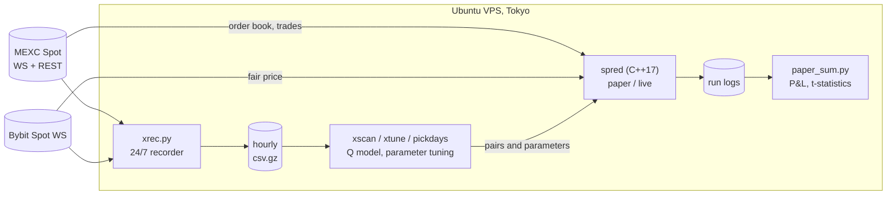

# MEXC Spread Bot

[🇷🇺 Русский](README.md) | 🇬🇧 English


**Market making on MEXC spot: a C++17 bot plus a Python research toolkit.**
A finished research project. The hypothesis was tested on real market data and rejected. The main result is an explanation of why this strategy does not work for a retail trader.

---

## Overview

| | |
|---|---|
| **Idea** | Quote bid/ask around a fair price and earn the spread (MEXC maker fee = 0) |
| **Stack** | C++17 (OpenSSL; own HTTP/TLS, WebSocket and protobuf parser), Python (numpy, pandas), Bash, Linux, Git |
| **Infrastructure** | Ubuntu VPS in Tokyo, close to MEXC servers: RTT to MEXC ~9 ms, to Bybit ~5 ms. 24/7 market data recording for 54 pairs |
| **Testing** | 2+ weeks of paper trading, A/B tests, paper vs. offline model reconciliation, t-statistics |
| **Size** | ~7,000 lines of C++, ~2,000 lines of Python |
| **Outcome** | Found the source of fake profits (synthetic volume) and showed that the real edge is too small for a retail participant |

## Project story

1. **Hypothesis.** Illiquid MEXC pairs have wide spreads and zero maker fees. Quoting both sides should capture the spread.
2. **Infrastructure.** To reduce latency I set up an Ubuntu VPS in Japan, where MEXC servers are located. I wrote the bot in C++ and a market data recorder in Python (systemd service).
3. **"Perfect" coins.** After a week of testing I found 2 pairs where paper trading showed **+2–8% per day**.
4. **Looking for the catch.** I analyzed the trade tape: **70–100% of trades printed strictly inside the spread**, regularly, about every 25–30 seconds, in the middle of the spread. These were the token's own bots generating volume (wash trading) to avoid delisting. The paper engine counted these prints as fills of my orders. A real participant would never get them, so the profit was an artifact. After I added a filter for such prints (F45/F47), the profit disappeared.
5. **Second attempt: liquid pairs.** I switched to quoting from the Bybit fair price, which is more liquid and moves before MEXC (F55). I added a stop-loss, a trend filter, position flattening on halt, and an Avellaneda–Stoikov model. Every change was validated with an A/B test.
6. **Result.** The edge exists (trade markout +2–10 bps) but yields only **~$0.01–0.03 per hour per pair** with $10 orders. That is below the threshold set in advance (≥ $0.05/h, t ≥ 2). On trending days inventory risk eats the whole spread. Taker arbitrage on the MEXC lag behind Bybit gives −2 to −28 bps after fees.
7. **Conclusion.** This market pays participants with direct exchange connectivity (colocation) and special terms from market-maker programs: rebates, higher API limits, priority. A retail participant on the public API cannot compete. The project was closed.

## Architecture



**`src/spred.cpp`: the bot (single file, OpenSSL only)**
- Multi-pair mode: one process handles N pairs; several processes share a rate limiter (`/dev/shm` + `flock`).
- Paper engine: FIFO queue model, network latency, synthetic print filter, per-pair fees.
- Live mode: signed REST requests, private WebSocket (protobuf), position reconciliation with the exchange, handling of disconnects, 429/418 and idempotent retries. The live path was debugged against a local TLS mock of the exchange with fault injection.
- Strategy: quoting from the Bybit price with an EWMA basis, P&L stop, trend filter, maker exit from position, Avellaneda–Stoikov.
- Detailed version history with every fix (F1–F64) is in the file header.

## How hypotheses were tested

- **A/B tests.** Control and new variant ran simultaneously on the same pairs. Paper trading does not affect the market, so the conditions are identical (`scripts/experiments/paper_fair7.sh`).
- **Two independent estimates.** The paper bot and the offline Q model built on recorded data agree in total (one night: −$8.34 vs −$9.36), with a 0.59 per-pair correlation. Another check compares paper trading with and without the print filter.
- **Stability.** Markout repeats day to day (correlation 0.36–0.53), so it is a real edge. P&L including inventory does not repeat (−0.45 to −0.03), so it is noise. Pairs were therefore selected by markout (`pickdays.py`).
- **Statistics.** t-statistics over pair-hours. The criterion for going live was fixed **before** testing.
- **Versioning.** Code was tracked in Git. Each new bot feature is behind its own flag; without flags the behavior matches the previous version, so old results stay reproducible.

## Key numbers

| What | Value |
|---|---|
| Trades inside the spread on illiquid pairs | 70–100% (synthetic) |
| Trade markout on normal pairs | +2–10 bps |
| Paper P&L, one night, 16 pairs, excluding trending pairs | +$0.021/h per pair, t = 1.2 |
| Threshold for going live | ≥ +$0.05/h per pair, t ≥ 2 |
| Taker arbitrage on the MEXC → Bybit lag | −2 to −28 bps after fees |
| Infrastructure stability | 10 h without reconnects, fresh Bybit price 94–99% of the time |

Real run logs with analysis (in Russian): [`results/`](results/). Details: [`docs/FINDINGS.md`](docs/FINDINGS.md) — findings, [`docs/JOURNAL_2026-10-06.md`](docs/JOURNAL_2026-10-06.md) — work journal.

## What I learned

- Low-level network programming in C++: TLS, WebSocket, protobuf parsing, rate limiting, disconnect handling.
- Deploying and maintaining a Linux server: Ubuntu, systemd, a 1 CPU / 1 GB budget, monitoring.
- Designing experiments: control groups, criteria fixed in advance, overfitting checks.
- Not trusting a good result until its cause is found — here, synthetic volume.
- Knowing when to stop: closing the project once the data showed the hypothesis was wrong.

## Repository structure

```
src/spred.cpp              bot (paper + live), C++17
tools/xrec.py, demon2.py   MEXC + Bybit recorder
tools/xscan.py, xtune.py   Q model and parameter tuning on recorded data
tools/pickdays.py          pair selection by stable markout
tools/lagtest.py           MEXC vs Bybit lag test
tools/paper_sum.py         run summary, t-statistics
tools/feecheck.py          account fees per pair
scripts/                   server maintenance and reports
scripts/experiments/       paper run configs, including A/B
docs/                      findings and journal (Russian)
results/                   paper run logs and summaries
```

## Build and run

```bash
sudo apt install g++ make libssl-dev python3-pip

# build the bot (Makefile)
make                                   # -> ./spred

# or manually
g++ -std=c++17 -O2 -o spred src/spred.cpp -lssl -lcrypto -lpthread

pip install -r requirements.txt

# market data recorder
nohup python3 tools/xrec.py --out data/x --auto 40 > xrec.log 2>&1 &

# one-hour paper run
mkdir -p data
MM_FAIR=bybit MM_ORDER_USDT=10 ./spred BONKUSDT,SANDUSDT 3600 > data/paper_test.out 2>&1
python3 tools/paper_sum.py data/paper_test.out
```

All parameters are set via `MM_*` environment variables and documented in the header of `src/spred.cpp` (comments are in Russian). API keys are needed only for live mode (see `.env.example`).

## Disclaimer

This is an educational research project, not investment advice. Live mode has not been fully tested with real money. Use at your own risk.
