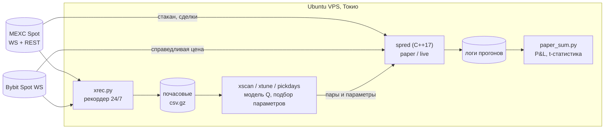

# MEXC Spread Bot


**Маркет-мейкинг на споте MEXC: бот на C++17 + инструменты анализа на Python.**
Исследовательский проект, завершён. Гипотеза проверена на реальных рыночных данных и опровергнута. Главный результат — объяснение, почему так зарабатывать нельзя.

> **TL;DR (EN).** C++17 market-making bot for MEXC spot (paper + live modes, own TLS/WebSocket/protobuf stack) and a Python research toolkit. Deployed on an Ubuntu VPS in Tokyo next to the exchange. After 2+ weeks of paper trading and A/B tests I found that the "profitable" fills on illiquid pairs were wash trades printed *inside* the spread by the token's own bots. On liquid pairs the real edge was too small for a retail participant. Project closed with a documented negative result.

---

## Коротко

| | |
|---|---|
| **Идея** | Ставить bid/ask вокруг справедливой цены и зарабатывать на спреде (мейкерская комиссия MEXC = 0) |
| **Стек** | C++17 (OpenSSL; свои HTTP/TLS, WebSocket и protobuf-парсер), Python (numpy, pandas), Bash, Linux, Git |
| **Инфраструктура** | Ubuntu VPS в Токио, рядом с серверами MEXC: RTT до MEXC ~9 мс, до Bybit ~5 мс. Круглосуточный сбор данных по 54 парам |
| **Тестирование** | 2+ недели в paper-режиме, A/B-тесты, сверка paper с офлайн-моделью, t-статистика |
| **Объём** | ~7 000 строк C++(paper+live), ~2 000 строк Python |
| **Итог** | Найдена причина ложной прибыли: синтетический объём. Доказано, что реального края не хватает для розничного трейдера |

## История проекта

1. **Гипотеза.** На неликвидных парах MEXC широкий спред, а мейкерская комиссия нулевая. Если держать котировки по обе стороны, можно забирать спред.
2. **Инфраструктура.** Чтобы уменьшить задержку, поднял VPS на Ubuntu в Японии (там стоят серверы MEXC). Написал бота на C++ и рекордер рыночных данных на Python (systemd-сервис).
3. **«Идеальные» монеты.** Через неделю тестов нашлись 2 пары, на которых paper-режим давал **+2…8 % в сутки**.
4. **Проверка: в чём подвох.** Разобрал ленту сделок. Оказалось, что **70–100 % сделок проходят строго внутри спреда**, причём регулярно: примерно раз в 25–30 секунд, в середине спреда. Это боты самого токена рисуют объём (wash trading), чтобы биржа не делистила монету. Paper-движок засчитывал такие принты как исполнение моих заявок. Реальный участник этих сделок не получил бы, значит прибыль была артефактом. Добавил в движок фильтр таких принтов (F45/F47), и прибыль исчезла.
5. **Вторая попытка: ликвидные пары.** Перешёл на котирование от справедливой цены Bybit: она ликвиднее и обновляется раньше MEXC (F55). Добавил стоп-лосс, фильтр тренда, закрытие позиции при остановке, модель Avellaneda–Stoikov. Каждое изменение проверял A/B-тестом.
6. **Результат.** Край существует (маркаут сделок +2…+10 bps), но приносит **~0.01–0.03 $/ч на пару** при ордере 10 $. Это ниже заранее заданного порога (≥ 0.05 $/ч, t ≥ 2). В трендовые дни инвентарный риск съедает весь спред. Тейкер-арбитраж на отставании MEXC от Bybit после комиссий даёт от −2 до −28 bps.
7. **Вывод.** На этом рынке зарабатывают участники с прямым подключением к бирже (колокация) и особыми условиями по программам маркет-мейкеров: ребейты, повышенные лимиты API, приоритет. Розничному участнику через публичный API с ними не конкурировать. Проект закрыт.

## Архитектура



**`src/spred.cpp`: бот (один файл, только OpenSSL)**
- Мультипарный режим: один процесс на N пар, несколько процессов с общим rate-limiter (`/dev/shm` + `flock`).
- Paper-движок: модель очереди FIFO, сетевая задержка, фильтр синтетических принтов, комиссии по парам.
- Live-режим: подписанные REST-запросы, приватный WebSocket (protobuf), сверка позиции с биржей, обработка обрывов, 429/418 и идемпотентные повторы. Live-контур отлажен на локальном TLS-моке биржи с имитацией отказов.
- Стратегия: котирование от цены Bybit с базисом (EWMA), стоп по P&L, фильтр тренда, мейкерский выход из позиции, Avellaneda–Stoikov.
- Подробная история версий с описанием каждого фикса (F1–F64) — в шапке файла.

## Как проверял гипотезы

- **A/B-тесты.** Контроль и новый вариант запускались одновременно на одних и тех же парах. Paper не влияет на рынок, поэтому условия одинаковые (`scripts/experiments/paper_fair7.sh`).
- **Две независимые оценки.** Paper-бот и офлайн-модель Q по записанным данным в сумме сходятся (ночь: −8.34 $ против −9.36 $), корреляция по парам 0.59. Ещё одна сверка — paper с фильтром принтов и без него.
- **Устойчивость.** Маркаут повторяется день ко дню (корреляция 0.36–0.53), значит это реальный край. P&L с учётом инвентаря не повторяется (от −0.45 до −0.03), значит это шум. Поэтому пары отбирались по маркауту (`pickdays.py`).
- **Статистика.** t-статистика по пар-часам. Критерий перехода к реальной торговле был зафиксирован **до** тестов.
- **Версионирование.** Код вёл в Git. Каждая новая функция бота включается своим флагом, без флагов поведение совпадает с предыдущей версией, поэтому старые результаты воспроизводимы.

## Ключевые цифры

| Что | Значение |
|---|---|
| Сделок внутри спреда на неликвидных парах | 70–100 % (синтетика) |
| Маркаут сделок на нормальных парах | +2…+10 bps |
| Заработок paper, ночь 16 пар, без трендовых пар | +0.021 $/ч на пару, t = 1.2 |
| Порог перехода к live | ≥ +0.05 $/ч на пару, t ≥ 2 |
| Тейкер-арбитраж на лаге MEXC → Bybit | −2…−28 bps после комиссии |
| Стабильность инфраструктуры | 10 ч без реконнектов, свежая цена Bybit 94–99 % времени |

Подробно: [`docs/FINDINGS.md`](docs/FINDINGS.md) — выводы, [`docs/JOURNAL_2026-10-06.md`](docs/JOURNAL_2026-10-06.md) — рабочий журнал.

## Чему научился

- Писать низкоуровневый сетевой код на C++: TLS, WebSocket, разбор protobuf, rate-limiting, обработка обрывов.
- Разворачивать и поддерживать Linux-сервер: Ubuntu, systemd, ресурсы 1 ядро / 1 ГБ, мониторинг.
- Строить эксперимент: контрольная группа, заранее заданные критерии, проверка на переобучение.
- Не верить хорошему результату, пока не найдена его причина. Здесь это синтетический объём.
- Вовремя остановиться: закрыть проект, когда данные показали, что гипотеза неверна.

## Структура

```
src/spred.cpp              бот (paper + live), C++17
tools/xrec.py, demon2.py   рекордер MEXC + Bybit
tools/xscan.py, xtune.py   модель Q и подбор параметров по записям
tools/pickdays.py          отбор пар по стабильному маркауту
tools/lagtest.py           тест отставания MEXC от Bybit
tools/paper_sum.py         итог прогона, t-статистика
tools/feecheck.py          комиссии аккаунта по парам
scripts/                   обслуживание сервера и отчёты
scripts/experiments/       конфигурации paper-прогонов, включая A/B
docs/                      выводы и журнал
```

## Сборка и запуск

```bash
sudo apt install g++ libssl-dev python3-pip
make                                   # -> ./spred
pip install -r requirements.txt

# рекордер данных
nohup python3 tools/xrec.py --out data/x --auto 40 > xrec.log 2>&1 &

# paper-прогон на час
mkdir -p data
MM_FAIR=bybit MM_ORDER_USDT=10 ./spred BONKUSDT,SANDUSDT 3600 > data/paper_test.out 2>&1
python3 tools/paper_sum.py data/paper_test.out
```

Все параметры задаются переменными окружения `MM_*` и описаны в шапке `src/spred.cpp`. Ключи API нужны только для live-режима (см. `.env.example`).

## Дисклеймер

Проект учебно-исследовательский и не является инвестиционной рекомендацией. Live-режим не прошёл полноценную проверку на реальных деньгах. Используйте на свой риск.
